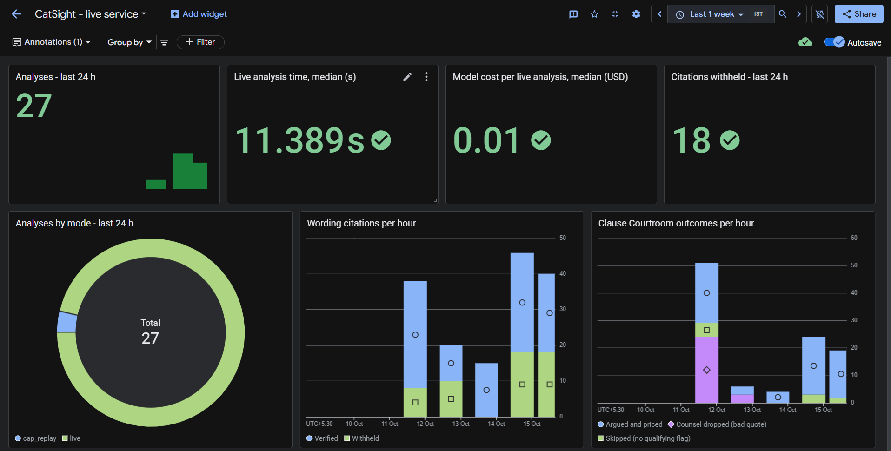
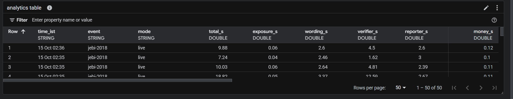

# CatSight

**When a typhoon or earthquake hits, CatSight shows a reinsurer, within a minute, who pays what under each contract, and which contract wording could change that answer.**

Google Cloud AI Builder Cup 2026 · BFSI: Intelligent Risk, Fraud & Financial Experiences · **Team Techno Crackers:** Venket Raj S, Malik Chandra Pandian, Arun Veerappan, Nagaraj (all 4 are working professionals in JAPAC; no students).

| | |
|---|---|
| **▶ Live demo** | https://catsight-api-342162443546.us-central1.run.app (no login) |
| **▶ Demo video** (2 min 48 s) | [Watch on Google Drive](https://drive.google.com/file/d/14Yv-A-KtVksOgRxOxafZcEKFBUvFumQi/view?usp=sharing) |
| **▶ Deck (PDF)** | [`docs/CatSight_deck.pdf`](docs/CatSight_deck.pdf) |
| **▶ Submission folder** | [Google Drive](https://drive.google.com/drive/folders/1X5cNQh4aMP-B1JIvIXyyxCL-4anxJhl4?usp=sharing) |
| **CI** | [`.github/workflows/ci.yml`](.github/workflows/ci.yml) |

## In 30 seconds

After a disaster, insurers must pay thousands of families and businesses quickly. They get much of that money back from **reinsurers**: insurers for insurance companies, bound by long legal contracts called **treaties**. Working out what each treaty pays takes days of manual review, and disputes over unclear wording can run for months. CatSight gives the first answer in seconds:

- **The money in 0.7 s** (median), calculated by tested code, never by the AI.
- **The full check in under a minute:** 23 s on average in 3 timed live runs on 15 Oct (8–43 s; the slowest run that day took 56 s), and 11.3 s median in the 10-run benchmark on 14 Oct. Gemini reads the contract wording, and every quote it uses is checked against the contract page.
- **About 1 cent of AI cost** per analysis ($0.0097 median).

*Measured on the live service; see [`docs/RESULTS.md`](docs/RESULTS.md) §1 and §1b.*

## For judges: try it in 2 minutes

1. Open the **live demo**. There's no login.
2. Press **Instant replay** (a recorded real live run, played back in a few seconds, no AI cost; a banner says when it was recorded and how long it took live) or **Run live** to watch the AI agents work (23 s on average on 15 Oct; under a minute in every run that day).
3. Follow the five steps on screen (*Event → Who's hit → What it costs → Clauses that matter → Decide*), or press **Take the tour** (9 stops).
4. In **Follow-up questions**, click one of the built-in examples. All three were checked on the live site on 15 Oct 2026:
   - *Which layers are exhausted, and on which treaties?*
   - *Show the hours clause for W1.*
   - *Why does T-004 matter for this event?*
5. Open the **Clause Courtroom**: two AI "lawyers" argue opposite readings of one unclear clause, and the engine prices both readings. It's a separate step: 42 s on average on 15 Oct (10–70 s); one later run that day took over 4 minutes.

**Good to know (limits, by design):**
- About **20 live runs per hour per visitor**, and **300 a day** for the whole site. Past a limit you get the recorded replay instead, clearly labelled, so the demo always completes.
- Questions that try to override the AI's instructions are **blocked**, by a local filter and by Google Cloud Model Armor. That's expected.
- Only the preloaded disasters can be analysed (no file upload).
- All companies and contracts are **fictional**. The disasters and the hazard data are real (see [Data](#data)).

## The words you need

- **Primary insurer (cedent):** the local insurer that sells policies to homes and businesses (for example, *Kogane Fire & Marine*).
- **Reinsurer:** the company that covers the insurer's biggest losses. Ours is the fictional **Lion Re**.
- **Treaty:** the contract between the insurer and its reinsurers.
- **Retention (deductible):** the part of the loss the insurer pays itself before the treaty pays.
- **Layer and burn %:** a treaty pays in slices ("layers"). Burn % is how much of a slice the disaster used up; 100% means fully paid out.
- **Reinstatement premium:** the fee to refill a used-up layer for the next disaster.
- **Disputed gap:** the money that depends on how one unclear clause is read (for example, wind damage vs. storm-surge flooding).

**Why it matters:** in Asia-Pacific, **91% of catastrophe losses are uninsured** ($65B in 2023), and **48% of insurers lack catastrophe models**. When reinsurance payments are slow or disputed, rebuilding is slower too.

**Where it fits.** Catastrophe models (Moody's RMS, Verisk) estimate *how big* the loss is. CatSight comes next: it applies that footprint to the reinsurer's own treaties and wording, showing *who pays what, and which clause could change it*. We use public footprints (NOAA IBTrACS, USGS ShakeMap); a licensed model's footprint could plug in behind the same interface.

## What it does

CatSight takes the side of a fictional reinsurer, **Lion Re**, and replays a real disaster over 24 synthetic treaties for 8 fictional insurers in Japan, the Philippines and Taiwan.

1. **Which treaties respond:** matched on peril, territory and period, with a reason for each one that doesn't.
2. **What each layer pays:** loss by region, payout per layer, burn %, reinstatement premium, and where the insurer, all reinsurers and Lion Re each end up.
3. **Which clauses change that answer:** Gemini searches the wordings for clauses that bite on *this* event. For Jebi: treaty T-004 excludes storm surge, and Osaka recorded a record 329 cm tide.
4. **Where each clause says so:** treaty, page and clause, with the quote checked against the contract. A quote that fails is withheld and shown as withheld.

| Feature | What it gives the analyst |
|---|---|
| **How was this calculated?** | Every treaty step by step: hazard, why it responded, insured value × damage % = loss, and each layer's formula with its citation |
| **Map** | Regions coloured by peak wind or shaking; click for insured value by insurer |
| **Follow-up questions** | Plain-language answers from the engine's figures and checked quotes |
| **What-if** | An hours clause on the real loss timeline, or a labelled hypothetical, priced by the engine |
| **Clause Courtroom** | Two AI lawyers argue opposite readings; the engine prices both; an arbiter summarises without deciding; the analyst records a position |
| **Treaties, Methodology, Knowledge base** | The treaty book checked against each wording, the versioned method, and how the clause library was built |
| **Reports** | Markdown and Word (.docx) downloads |

## The AI never does the maths

Every money figure comes from unit-tested Python (`Decimal`, half-up rounding), checked against a hand-worked example. Gemini reads, argues and writes; tested code calculates.

**How a change is made.** Contract terms, damage curves and market rules are data, not code:

| What changes | Where it lives | How you change it |
|---|---|---|
| Treaty terms at renewal (retention, limit, share, reinstatements, hours clause, exclusions) | [`treaties.json`](backend/data/book/treaties.json) | Edit the data; no code change. Re-run `ingest.reconcile` to flag any mismatch with the PDF, then re-seed |
| Damage curves and market rules (reinstatement basis, retention per occurrence, rounding) | [`methodology.json`](backend/data/methodology.json) + [`vulnerability.json`](backend/data/vulnerability.json) | Add a new method version with its own effective date; old ones are never edited. The engine uses the version in force on the day and stamps it on every analysis |
| The formulas (layer payout, quota share, occurrence split) | [`loss_engine.py`](backend/catsight_agent/tools/loss_engine.py) | A code change, guarded by the worked example and the test suite |
| A one-off "what if" | The What-if panel | No edit: override hours or retention within checked bounds |

## Guardrails: how it avoids making things up

- **Contract quotes:** matched word-for-word against the stored page, then a second Gemini model checks the quote supports the claim. One retry; if it still fails, it is withheld and counted.
- **Numbers in AI-written text:** checked against the engine; anything untraceable is listed as unsupported.
- **Follow-up questions:** the question and the answer are screened by a local filter, then **Google Cloud Model Armor** (prompt injection, jailbreak, malicious URLs, harassment, hate speech). Live, a jailbreak attempt returns *"Question blocked by Google Cloud Model Armor (ask: pi_and_jailbreak)."* If Model Armor is unavailable (3 s timeout), the local filter still applies and the event is logged.
- **Contract text is data, not instructions:** agents ignore instructions inside documents.
- **People decide:** the arbiter only summarises; the analyst records the position.

## Why it's fast

- **Money first:** plain code calculates it before any AI call, so it's on screen in 0.7 s.
- **Streaming:** results appear as each step finishes (server-sent events).
- **A fixed workflow,** not an open-ended AI tool loop, so no wasted model calls.
- **Parallel lawyers:** both Courtroom sides run at once.
- **Narrow search:** contract search is filtered to one treaty, and standard searches are pre-computed, so a fresh server makes no embedding calls during an analysis.
- **No cold start:** one warm Cloud Run instance during judging.

**What makes a run slower:** checking. When a quote fails its first check, the AI revises it and the checker runs again. On 15 Oct the runs that needed this took 17–43 s, and the run that passed first time took 8 s ([`docs/RESULTS.md`](docs/RESULTS.md) §1b).

## Architecture (as built)

```
Browser (React) ──SSE──► Cloud Run: FastAPI
                            │
     ADK 2.11 Workflow:  event_intel → exposure_analyst → wording_checker → verifier → reporter
                                          (loss engine,     (Firestore        (quote match
                                           no model)         vector search     + support check
                                                             + Gemini)          on Gemini 3.8)
     Clause Courtroom:   brief → ┌ cedent_counsel    ┐ → join → price (engine) → arbiter
                                 └ reinsurer_counsel ┘   (parallel fan-out)
                            │
     Firestore: treaty book, events, method versions, 252 clause vectors,
                ingestion evidence, completed runs · Cloud Storage: treaty PDFs
     Model Armor: question and answer screening · Cloud Logging / Trace / Monitoring
```

- **Models:** `gemini-3.5-flash-lite` (agents), `gemini-3.8-flash` (checking and arbiter), `gemini-embedding-001` at 768 dims, on **Gemini Enterprise Agent Platform (formerly Vertex AI, global endpoint)**. Service-account auth, no API keys.
- **Contract search (RAG):** wordings are split into clauses with page numbers (one scanned page is transcribed by Gemini once), embedded, and stored in **Firestore vector search**, filtered by treaty. At 252 clauses Firestore fits well; AlloyDB AI suits far larger vector sets.
- **Serving:** one Cloud Run service serves the UI and the API from one origin.
- **Cost guards:** per-visitor hourly limit (right-most `X-Forwarded-For` hop from Cloud Run's load balancer), a daily cap with replay fallback, `--max-instances 3`, a least-privilege service account, billing budget alerts.

Detail in [`docs/ARCHITECTURE.md`](docs/ARCHITECTURE.md).

## Seeing it run: observability

Every run writes structured logs to **Cloud Logging** (one line per stage, with the run id), and ADK's OpenTelemetry spans go to **Cloud Trace**. Guardrail events are named (`citation_withheld`, `unsupported_figures`, `counsel_dropped`, `limit_refused`, `guardrail_blocked`, `model_armor_unavailable`) and become **Cloud Monitoring** metrics. No raw IPs, question text or prompts are logged.



*The "CatSight - live service" dashboard (screenshot from 15 Oct 2026). "Citations withheld" counts quotes the checker refused to show: the guardrail doing its job, not an error.*



*Per-run table (Log Analytics SQL): seconds spent in each agent for every run. The query is [`scripts/observability_runs.sql`](scripts/observability_runs.sql), and the dashboard layout is [`scripts/observability_dashboard.json`](scripts/observability_dashboard.json).*

The dashboard lives in our private Google Cloud project, so these screenshots stand in for a link.

## Measured results

| Measure | Result | Notes |
|---|---|---|
| Loss engine vs the hand-checked worked example | exact | QA-1 |
| Treaty-term extraction (RAG-first) | **99.5%** (185/186 fields) | an upper bound: measured on the 8 wordings the prompts were developed against; no blind set yet |
| Governing clause retrieved | **186/186** | Firestore vector search |
| Citation coverage | **186/188** fields cited; **185/186** check out against the page | per-field audit in [`docs/RESULTS.md`](docs/RESULTS.md) §3; 1 scanned page is labelled "transcribed" |
| Extraction time, 8 wordings | **57 s** | vs ~25 min for whole-document extraction |
| Live analysis (Jebi), 10-run live benchmark | money in **0.7 s** p50 (0.5–1.1 s); complete in **11.3 s** p50 (7.8–19.3 s); **$0.0097** p50 model cost ($0.0081–$0.0140) | warm service on Cloud Run; [`docs/RESULTS.md`](docs/RESULTS.md) §1 |
| Clause Courtroom | **Ran in 8 of 10 live analyses** (skipped in 2 when the verifier withheld the T-004 flag); **both sides verified in all 8**; 8.0 s p50 (7.1–45.2 s), $0.0052 p50 cost | prices the money at stake live: on the recorded 20% surge-share run, reinsurers pay $11.6M less and the insurer's net cost rises $10.3M; measured insurer range +$10.3M to +$26.0M |
| Browser check, 3 live runs (15 Oct) | analysis **23.0 s** average (8.2–43.3 s); Courtroom **41.7 s** average (10.3–69.8 s); $0.0091 average model cost | timed from the click, as a visitor sees it; [`docs/RESULTS.md`](docs/RESULTS.md) §1b |
| Follow-up question | about **$0.003** | from token counts, not benchmarked |
| Automated tests | **870+ offline tests + 13 opt-in live tests** | run on a fresh clone (CI in [`.github/workflows/ci.yml`](.github/workflows/ci.yml)) |

*What the demo video shows:* one live run recorded on 15 Oct, walking the five steps above: the run (10 s), Who's hit with *How was this calculated?*, What it costs, the clauses and the Courtroom (26 s), the checked quote and scanned endorsement, then What-if, the Word report and a follow-up question. Its lawyers argued a **50%** surge share, the most common outcome in the benchmark (6 of 8 Courtrooms): $29.09M of recoveries move and Lion Re saves $5.16M. The replay and the deck use the **20%** run. Each figure is boxed on screen as the narration says it; long waits are cut, never sped up, and each cut is captioned with the real time.

## Run it yourself

Prerequisites: Python 3.12 with [uv](https://docs.astral.sh/uv/), Node LTS, and for the AI features the Google Cloud CLI signed in with `gcloud auth application-default login` to a project that has Gemini Enterprise Agent Platform (Vertex AI) and Firestore enabled.

**1. Backend (first time)** - in `backend/`:

```powershell
uv venv --python 3.12
uv pip install -r requirements.txt -r requirements-dev.txt
copy .env.example .env          # then set GOOGLE_CLOUD_PROJECT and GCS_BUCKET
uv run --no-sync python -m ingest.build_wordings   # generates the treaty PDFs (also auto-run by pytest)
```

**2. Start the API** - in `backend/`:

```powershell
# Numbers only, no cloud needed (reads local JSON):
uv run --no-sync uvicorn app.main:app --port 8080

# Full system - agents, Firestore, vector search (needs the GCP sign-in):
$env:DATA_BACKEND="firestore"; $env:EMBED_CACHE="data/cache/embeddings.jsonl"
uv run --no-sync --env-file .env uvicorn app.main:app --port 8080
```

**3. Start the UI** - in `frontend/`, in a second terminal:

```powershell
npm install
npm run dev        # open http://localhost:5173
```

**4. Tests** - in `backend/`:

```powershell
uv run --no-sync pytest -q                                   # 870+ offline tests, no cloud calls (auto-builds PDFs on fresh clone)
$env:RUN_LIVE="1"; uv run --no-sync --env-file .env pytest -m live -q   # 13 live tests against real Gemini + Firestore
```

**One-time data jobs** (already done for this project; re-run only if the data changes) - in `backend/`:

```powershell
uv run --no-sync --env-file .env python -m ingest.rag_pipeline --store firestore   # embed + extract wordings
uv run --no-sync python -m ingest.reconcile                                        # book vs wording
uv run --no-sync --env-file .env python -m ingest.seed_cloud --apply               # seed Firestore + Storage
```

## Deploy (Cloud Run)

Run in **Google Cloud Shell** (bash), from the repo root:

```bash
PROJECT_ID=<your-project-id> ./scripts/setup_model_armor.sh         # once, before the first deploy: question screening
PROJECT_ID=<your-project-id> ./scripts/deploy.sh                    # scale to zero (default)
PROJECT_ID=<your-project-id> MIN_INSTANCES=1 ./scripts/deploy.sh    # judging window: one warm instance
./scripts/smoke_test.sh <service-url>
```

The deploy script builds the UI into the image, so one Cloud Run service serves both the UI and the API. It runs as the dedicated `catsight-run` service account, turns on Cloud Trace, and applies the cost guards.

**Observability** (once per project):

```bash
PROJECT_ID=<your-project-id> ./scripts/setup_observability.sh   # log-based metrics + the dashboard above
```

Add `BILLING_ACCOUNT=… BUDGET_INR=…` to the observability script for a budget alert. Per-agent timelines are in **Cloud Trace**; nothing is built into the app itself.

## Limitations

- **Hours clause is hypothetical here.** No real event in our data makes an hours clause move money (Jebi's damage lasted 9 hours; Noto's aftershock causes no loss in our model), so What-if labels it *hypothetical*. The Courtroom argues the real storm-surge exclusion instead.
- **Surge share is an assumption** (bounded 0–50%), because the data doesn't separate wind from surge damage.
- **Typhoon Haiyan is hidden from the demo.** The synthetic Philippine book is sized like Japan's, so modelled claims (~$94B) are far above the real ~$1.5B insured loss. Per-country calibration is future work ([`ASSUMPTIONS.md`](backend/data/ASSUMPTIONS.md) X11).
- **AI output varies** between runs, even at temperature 0. Extraction prompts were tuned on the same eight wordings they are scored on, so those scores are an upper bound.
- **Manual-effort comparisons are labelled *simulated*:** an estimate, not a timed study.
- **The rate limit is a cost guard, not security:** 20/hour is counted per Cloud Run instance (up to 3).
- **Demo scope:** no user accounts (the analyst-position endpoint has no login), and no public upload (mode "live" returns 501).
- Every modelling assumption is in [`backend/data/ASSUMPTIONS.md`](backend/data/ASSUMPTIONS.md).

## Future work

Designed or investigated, not built:

- **A real hours-clause dispute:** the 2024 Hualien earthquake (Taiwan). Its real aftershock cluster about 20 days later is a second occurrence worth about $11-15M per treaty.
- **Per-treaty hours clauses and multi-shock earthquakes** in the main analysis, not only in What-if.
- **Damage curves calibrated per country,** which would bring Haiyan back.
- **Upload your own wordings:** the ingestion pipeline already reads any PDF; public upload is held back for cost and safety.
- **Live event feeds:** a USGS or JTWC alert starts an analysis automatically.

## How it maps to the judging criteria

| Criterion | Where to look |
|---|---|
| **Technical merit** | ADK 2.11 `Workflow` graphs (5-node analysis with a bounded verify-and-revise loop; Courtroom with a parallel fan-out and `JoinNode`); RAG on Firestore vector search; a citation checker that withholds ungrounded claims; Model Armor screening; a deterministic engine with 870+ offline + 13 live tests; Cloud Logging, Trace and Monitoring. [`ARCHITECTURE`](docs/ARCHITECTURE.md), [`RESULTS`](docs/RESULTS.md) |
| **Problem alignment & impact** | The first question a reinsurer faces after a disaster, answered per treaty and per party. [`BUSINESS_IMPACT`](docs/BUSINESS_IMPACT.md), [`DOMAIN_PRIMER`](docs/DOMAIN_PRIMER.md) |
| **Innovation** | Two AI lawyers argue a disputed clause from checked wording; tested code prices both readings; Gemini reads a scanned endorsement that changes the contract. [`MONEY_MOMENT`](docs/MONEY_MOMENT.md) |
| **User experience** | Five-step layout, sticky summary, guided tour, instant replay, example questions, light and dark themes with colour-blind-checked palettes, keyboard navigation, Word export |

## Team Techno Crackers

| Member | Role & contributions |
|---|---|
| **Venket Raj S** (Team Lead) | System architecture, Google Cloud Run / Firestore / IAM deployment, observability pipeline, integration & release |
| **Malik Chandra Pandian** | Reinsurance domain modelling, deterministic `Decimal` loss engine (`CAT_XL` & `QS`), worked examples & synthetic book calibration |
| **Arun Veerappan** | ADK 2.11 agent workflows, RAG-first treaty extraction, 2-stage citation verifier loop, parallel Clause Courtroom & QA audit |
| **Nagaraj** | React 18 + TypeScript + custom SVG choropleth UI, 5-step analyst layout, guided tour, accessibility palettes & Word/Markdown export |

*Note on git history:* built during the hackathon window in a private working copy and first pushed to this repository on 10 Oct 2026; every change since is an individual commit.

## Documentation

| | |
|---|---|
| [`docs/ARCHITECTURE.md`](docs/ARCHITECTURE.md) | Agent graph, data flows and service set-up |
| [`docs/RESULTS.md`](docs/RESULTS.md) | Every measured figure, the per-field citation audit, and what is not yet measured |
| [`docs/BUSINESS_IMPACT.md`](docs/BUSINESS_IMPACT.md) | Who uses it, what it saves, and how that was estimated |
| [`docs/DOMAIN_PRIMER.md`](docs/DOMAIN_PRIMER.md) | Reinsurance terms and the worked example |
| [`docs/MONEY_MOMENT.md`](docs/MONEY_MOMENT.md) | The per-party money story, number by number |
| [`backend/data/ASSUMPTIONS.md`](backend/data/ASSUMPTIONS.md) | Every modelling assumption and decision, with its status |

IDs such as `FR-LOSS-2`, `QA-1` or `B6` in code, tests and commit messages refer to the team's internal requirement list: `FR` a functional requirement, `QA` an acceptance test, `B` a benchmark.

## Data

**Why synthetic contracts?** Real reinsurance treaties and their wordings are confidential and never published, so the portfolio, the 8 insurers and the 24 treaty wordings are **entirely synthetic**: fictional companies, with wordings written in the style of public contracts. The **disasters and hazard data are real**: NOAA IBTrACS v04r01 (Knapp et al. 2010, doi:10.25921/82ty-9e16), USGS ShakeMap (public domain), Natural Earth (public domain). A reinsurer would load its own treaty book and PDF wordings through the same ingestion pipeline. No real employer, client or broker data is used anywhere.

## Licence

Apache-2.0 - see [`LICENSE`](LICENSE).

---

*Indicative first view on synthetic data. Not a catastrophe-model output. Not underwriting or claims advice. Issue-spotting only - not legal advice.*

*Jebi, Hagibis, Haiyan and Noto were real events in which people died. This project treats them as such.*
